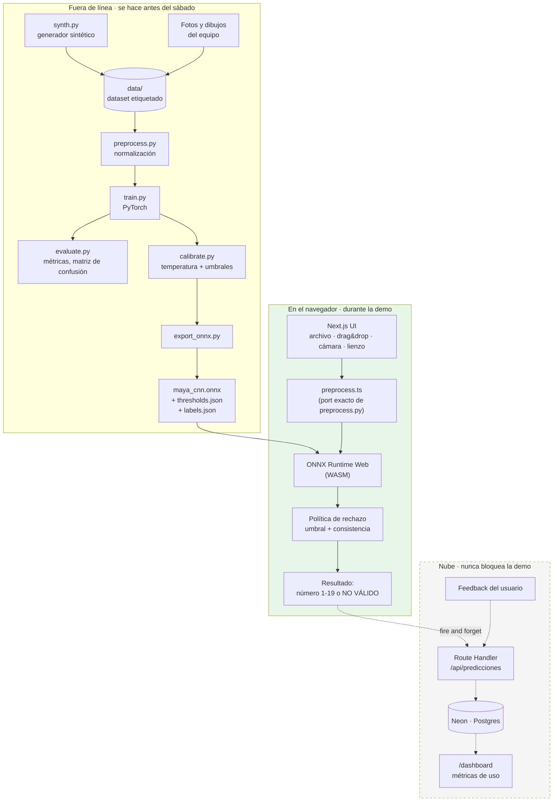
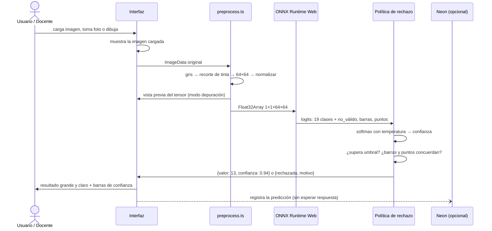

# 01 · Arquitectura

## Principio rector

> **La demo tiene que funcionar aunque no haya internet en la Biblioteca.**

El 50% de la nota se juega en pruebas en vivo con calificación binaria. Por eso la inferencia
corre **dentro del navegador**: el modelo se descarga una vez y a partir de ahí todo ocurre en
la máquina del equipo. La nube (Vercel, Neon) sirve para distribuir la app y para recolectar
datos, nunca para que la demo funcione.

## Vista en anillos

Cada anillo solo puede depender de los de adentro. El núcleo no sabe nada de Next.js, de Vercel
ni de Postgres; eso hace que el mismo código de inferencia se pueda probar aislado.

```
        ┌──────────────────────────────────────────────────────┐
        │  ANILLO 4 · Infraestructura                          │
        │  Vercel (hosting + CDN + funciones) · Neon (Postgres) │
        │  GitHub Actions · Vercel Blob                        │
        │ ┌──────────────────────────────────────────────────┐ │
        │ │  ANILLO 3 · Interfaz y entrega                   │ │
        │ │  Next.js · React · Tailwind · shadcn/ui          │ │
        │ │  Cargador de imágenes · cámara · lienzo de dibujo│ │
        │ │ ┌──────────────────────────────────────────────┐ │ │
        │ │ │  ANILLO 2 · Motor de inferencia              │ │ │
        │ │ │  ONNX Runtime Web (WASM) · preprocess.ts     │ │ │
        │ │ │  política de rechazo · calibración           │ │ │
        │ │ │ ┌──────────────────────────────────────────┐ │ │ │
        │ │ │ │  ANILLO 1 · Núcleo del dominio           │ │ │ │
        │ │ │ │  labels.py / labels.ts                   │ │ │ │
        │ │ │ │  (barras, puntos) → valor 1..19          │ │ │ │
        │ │ │ │  contrato del tensor 1×1×64×64           │ │ │ │
        │ │ │ └──────────────────────────────────────────┘ │ │ │
        │ │ └──────────────────────────────────────────────┘ │ │
        │ └──────────────────────────────────────────────────┘ │
        └──────────────────────────────────────────────────────┘
```

**Anillo 1 — Núcleo.** La definición de qué es un número maya: 19 clases, cada una un par
(barras, puntos). El contrato del tensor de entrada. No depende de nada.

**Anillo 2 — Inferencia.** Convierte una imagen cualquiera en un veredicto. Preprocesamiento,
ejecución del `.onnx`, calibración y política de rechazo. Es código puro, testeable sin UI.

**Anillo 3 — Interfaz.** Todo lo que el usuario toca. Puede cambiar entera sin tocar el anillo 2.

**Anillo 4 — Infraestructura.** Dónde vive. **Si el anillo 4 se cae, los anillos 1 a 3 siguen
funcionando.** Esa es la propiedad que nos salva el sábado.

## Componentes



Las flechas punteadas son opcionales **por diseño**: si fallan, no pasa nada visible.

## Flujo de una predicción



## Contrato del modelo

Este contrato lo respetan Python, TypeScript y el `.onnx`. Cambiarlo obliga a reentrenar.

| | |
|---|---|
| **Entrada** | `input`: `float32[N,1,64,64]`, valores en `[0,1]`, tinta clara sobre fondo oscuro |
| **Salida `logits`** | `float32[N,20]` — 19 clases válidas (índices 0–18 = números 1–19) + índice 19 = `no_valido` |
| **Salida `barras`** | `float32[N,4]` — cantidad de barras predicha (0–3) |
| **Salida `puntos`** | `float32[N,5]` — cantidad de puntos predicha (0–4) |
| **Artefactos** | `maya_cnn.onnx`, `labels.json`, `thresholds.json` (temperatura y umbrales), `metadata.json` (id de corrida, fecha, métricas) |

Las cabezas de barras y puntos no son decorativas: sirven para la **verificación de consistencia**
(si la clase principal dice 13 pero las cabezas dicen 2 barras y 1 punto = 11, algo está mal) y
para explicar en la presentación *por qué* la red decidió lo que decidió. Detalle en `04-MODELO.md`.

## Base de datos (Neon)

Postgres serverless en Neon, accedido desde Route Handlers de Next.js con el driver HTTP
`@neondatabase/serverless` (no abre conexiones TCP, que es lo que funciona en serverless).

```sql
create table predicciones (
  id            bigserial primary key,
  creado_en     timestamptz not null default now(),
  origen        text not null,          -- 'archivo' | 'camara' | 'lienzo'
  valor         smallint,               -- 1..19, o null si fue rechazada
  rechazada     boolean not null,
  motivo        text,                   -- 'baja_confianza' | 'clase_no_valida' | 'inconsistencia'
  confianza     real not null,
  barras        smallint,
  puntos        smallint,
  ms_inferencia integer,
  modelo        text not null,          -- id de la corrida que produjo el .onnx
  hash_imagen   text,                   -- sha256, para deduplicar
  blob_url      text                    -- Vercel Blob, solo si el usuario autoriza
);

create table retroalimentacion (
  id            bigserial primary key,
  prediccion_id bigint references predicciones(id) on delete cascade,
  correcta      boolean not null,
  valor_real    smallint,               -- lo que el usuario dice que era
  creado_en     timestamptz not null default now()
);

create index on predicciones (creado_en desc);
create index on predicciones (valor) where not rechazada;
```

**Para qué sirve, concretamente:**

1. **Volante de datos.** Cada imagen que el modelo falla y el usuario corrige entra al dataset
   de la siguiente iteración. Es la forma más barata de conseguir ejemplos difíciles reales.
2. **Evidencia para la presentación.** Un `/dashboard` con el conteo real de predicciones,
   la distribución por clase y la tasa de rechazo es material visual honesto (criterio 3, 5%).
3. **Análisis de errores (criterio 2, 5%).** La tabla de retroalimentación es, literalmente, el
   registro de casos en los que el modelo se equivocó.

**Regla no negociable:** toda escritura a Neon es *fire and forget* dentro de un `try/catch` que
se traga el error. Si Neon no responde, el usuario no se entera. Ver I5 en `CLAUDE.md`.

## Despliegue

```
GitHub (main)  ──push──►  Vercel
                            ├── build de Next.js
                            ├── estáticos + .onnx servidos por CDN
                            └── Route Handlers (serverless) ──► Neon
```

Preview deployment por cada rama, producción desde `main`. Detalle en `06-DESPLIEGUE.md`.

## Riesgos de arquitectura y cómo los contenemos

| Riesgo | Impacto | Mitigación |
|---|---|---|
| El preprocesamiento de TS difiere del de Python | **Crítico.** El modelo falla en vivo con métricas excelentes | Test de paridad automatizado contra tensores de referencia; se corre en CI y antes de cada despliegue |
| El `.onnx` no carga en el navegador del día | **Crítico.** No hay demo | Probar en el laptop y navegador exactos de la presentación; llevar el repo clonado y `npm run build` local como respaldo |
| Wifi de la Biblioteca caído | Alto | Inferencia en el navegador; app funciona offline; llevar la build local corriendo en `localhost` |
| El docente dibuja con un trazo que nunca vimos | Alto | Dataset sintético con jitter de trazo agresivo + fotos reales de 5 manos distintas |
| Neon no responde | Nulo si respetamos el diseño | Escrituras opcionales, sin bloqueo |
| El modelo pesa demasiado para el navegador | Medio | CNN propia compacta (objetivo < 2 MB en fp32); medir y registrar el tamaño |
